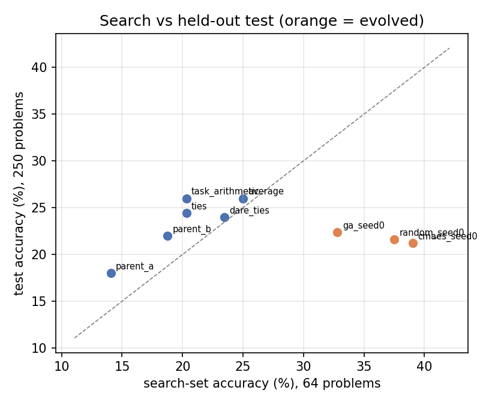

# evo-merge: Evolutionary Optimization of Model Merging Recipes

Soft Computing project (Thapar Institute, 2026). A small-scale reproduction of
[Akiba et al., "Evolutionary Optimization of Model Merging Recipes" (Sakana AI, 2024)](https://arxiv.org/abs/2403.13187).

**Idea.** Two language models fine-tuned from the same base model can be combined into one model
without any training, by mixing their weights. How much each layer takes from each parent decides
whether the merge works. We use a genetic algorithm to search for those per-layer mixing weights,
using accuracy on a task as the fitness function.

**Our setting.** The paper merged a Japanese model with a math model to get Japanese math reasoning.
We do the same for Hindi:

| Role | Model |
|---|---|
| Base (common ancestor) | `Qwen/Qwen2.5-1.5B` |
| Parent A (general, multilingual) | `Qwen/Qwen2.5-1.5B-Instruct` |
| Parent B (math) | `sunblaze-ucb/Qwen2.5-1.5B-GRPO-MATH-1EPOCH` (GRPO on MATH, from the same base) |
| Task | Hindi GSM8K (`bingbangboom/gsm8k-hindi`) |

## Results

Full write-up: [report/Soft_Computing_Project_Report.docx](report/Soft_Computing_Project_Report.docx)
(source: [report/report.md](report/report.md)). Every number is logged in [docs/findings.md](docs/findings.md).

Test accuracy on 250 held-out Hindi GSM8K problems:

| Candidate | Test | Search set (64) |
|---|---|---|
| 50/50 average | **26.0%** | 25.0% |
| Task arithmetic (1, 1) | **26.0%** | 20.3% |
| TIES / DARE-TIES | 24.4% / 24.0% | 20.3% / 23.4% |
| GA, evolved | 22.4% | 32.8% |
| CMA-ES, evolved | 21.2% | 39.1% |
| Random search, best | 21.6% | 37.5% |
| Parents: GRPO-MATH / Instruct | 22.0% / 18.0% | 18.8% / 14.1% |

- **Merging works:** uniform merges beat both parents (significant against Instruct, p = 0.007).
- **Evolved recipes overfit the 64-problem fitness set.** Re-picking each search's winner on 250 unseen
  validation problems did not help: search fitness and validation accuracy are uncorrelated
  (r = -0.05 over 30 candidates). With a fitness this noisy (about ±5 points), the optimizers fit noise.
- **The official Qwen2.5-Math model cannot be merged** with its sibling: its task vector is about
  130% of the base weights, against about 1% for an ordinary fine-tune.
- **The GA converged prematurely** (diversity collapsed at generation 9); CMA-ES kept exploring.



## Method

**Merge (parameter space).** For every parameter of the model,

```
theta = base + w[A, g] * (theta_A - base) + w[B, g] * (theta_B - base)
```

where `g` is the parameter's group: the embeddings, one of the 28 transformer layers, or the final
norm. That gives **60 weights** (2 parents x 30 groups). `theta_k - base` is parent k's *task
vector*. TIES and DARE variants of the merge are also implemented (`--set merge_method=dare_ties`).

**Genetic algorithm** (`evomerge/optimizers.py`, written from scratch):

| Component | Choice |
|---|---|
| Chromosome | 60 real-valued genes in [0, 2] (above 1 scales a task vector up) |
| Initial population | both parents, their average, the rest uniform random |
| Fitness | accuracy on 64 Hindi GSM8K training problems (greedy decoding) |
| Selection | 3-way tournament |
| Crossover | BLX-alpha blend crossover, alpha = 0.3, rate 0.9 |
| Mutation | Gaussian, per-gene rate 0.15, sigma 0.15 decaying 5% per generation |
| Elitism | best 2 kept unchanged (and not re-evaluated) |
| Budget | 170 fitness evaluations |

**Comparisons**, all on 250 held-out test problems (the `test_main` split). The search scores answers
with at most 512 new tokens (`max_new_tokens`); the test set allows 1024 (`test_max_new_tokens`), because
the pilot showed the 512 limit cuts off many long Hindi answers:
- each parent alone
- plain weight averaging, task arithmetic, TIES and DARE-TIES
- CMA-ES (the paper's optimizer) and random search, each with the same 170-evaluation budget

## Layout

```
evomerge/
  config.py       experiment settings (JSON + --set overrides)
  data.py         fixed problem subsets from Hindi GSM8K
  answers.py      answer extraction (\boxed{}, last number, Devanagari digits)
  merge.py        layer-wise merge engine: task arithmetic, TIES, DARE
  optimizers.py   GA (from scratch), CMA-ES, random search; ask/tell + resumable state
  runtime.py      model loading and the accuracy evaluator
  search.py       CLI: run a search, checkpoint every generation
  evaluate.py     CLI: test-set accuracy of baselines and evolved recipes
  diagnose.py     CLI: task-vector size per layer (is a pair mergeable?)
  plots.py        convergence curve, evolved weight profile, accuracy bar chart
configs/          qwen_hindi_math.json (full run), smoke.json (tiny local check),
                  qwen_official_math.json (the unmergeable pair, for the report)
docs/findings.md  results and negative results as they come in
notebooks/        kaggle_run.ipynb (generated by build_kaggle_notebook.py)
tests/            GA on sphere/Rastrigin, merge identities, answer parsing
```

## Running

```bash
pip install -r requirements.txt
python -m pytest -q
```

Quick local check (8 problems, 8 evaluations; needs about 6 GB of GPU memory and 12 GB of RAM):

```bash
python -m evomerge.search --config configs/smoke.json --optimizer ga --run smoke_ga
```

Full experiment on Kaggle (free 2x T4):
1. Upload `evo-merge-kaggle.zip` (code only, no local runs) as a Kaggle Dataset.
2. Import `notebooks/kaggle_run.ipynb` into a new notebook. Attach the dataset with Add Input, and set
   GPU T4 x2 with Internet on.
3. Save Version, then Save & Run All (Commit). The notebook runs, in order:
   - GA and CMA-ES in parallel (one per GPU)
   - random search alongside the baseline test evaluation
   - the evolved recipes on the test set
   - the figures

   Each stage skips finished work, and each search stops cleanly before Kaggle's 12-hour limit
   (`--time-limit-hours`).
4. If the last cell says NOT FINISHED, attach that version's Output as an input and run it again.
   Searches resume from their last finished generation.

## Notes

- **Why not the official Qwen2.5-Math model?** It was the first choice, but its task vector is as
  large as the base weights (continued pretraining, not a fine-tune) and it uses a different RoPE base,
  so every merge with it collapses. See [docs/findings.md](docs/findings.md). Check any new pair with
  `python -m evomerge.diagnose` before searching: both parents' relative task vectors should be
  small (around 0.01-0.1).
- **Memory.** The base and both parents are held in CPU RAM (about 9 GB in fp16). Each merge is
  computed on the GPU in chunks of at most 16M elements and written directly into the live model,
  so no merged checkpoint is ever saved to disk during the search.
- **Fitness noise.** Decoding is greedy, so the fitness of a genome is deterministic. It is
  measured on only 64 problems, though, so the final comparison uses the separate 250-problem test set.
