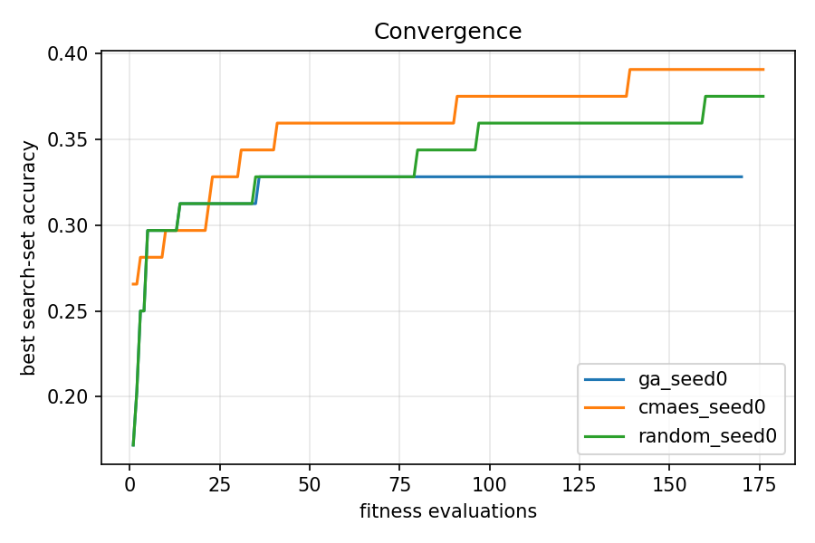
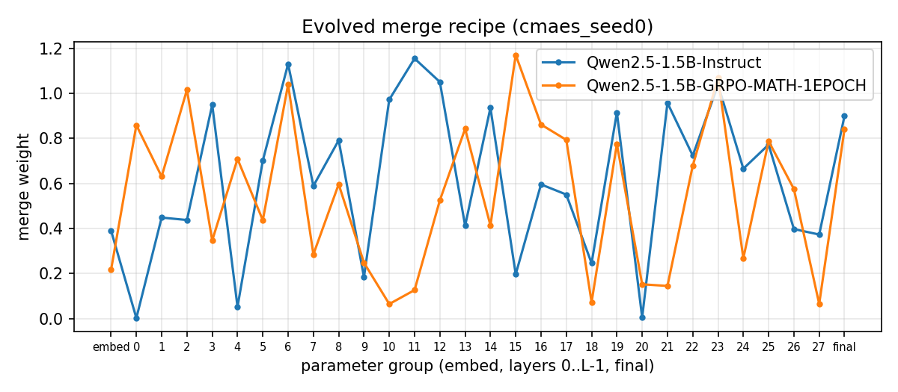

# Evolutionary Optimization of Model Merging Recipes for Hindi Math Reasoning

**Soft Computing: Project Report**, Thapar Institute of Engineering and Technology, Patiala

| Team member | Roll number |
| --- | --- |
| Naman Kundra | 102315069 |
| [Partner's name] | [Partner's roll number] |

Instructor: Dr. Mayank Agarwal. Topic: reproduction of Akiba et al., "Evolutionary Optimization of Model Merging Recipes" (Sakana AI, 2024). October 2026.

## Abstract

Merging two fine-tuned 1.5B-parameter language models improves Hindi math accuracy over both parents (26.0% vs 22.0% and 18.0% on 250 held-out problems). Evolving a per-layer merge recipe with a genetic algorithm did not improve on that. We reproduce, at small scale, the idea of Akiba et al.: search a merge recipe with an evolutionary algorithm instead of choosing it by hand.

We merge Qwen2.5-1.5B-Instruct (general, multilingual) with a GRPO math fine-tune of the same base model. The recipe is 60 real-valued weights, one per parent for each of 30 parameter groups, and the fitness is accuracy on Hindi GSM8K. We compare a genetic algorithm written from scratch with CMA-ES and random search at an equal budget of 170 evaluations.

The searches raised their fitness from 25% to 33-39%, but the evolved recipes scored 21-22% on the held-out test set, below uniform merging. A follow-up that re-picked winners on a separate 250-problem validation set confirmed that the search fitness carried no information about held-out accuracy (r = -0.05 over 30 candidates). The cause is a fitness measured on 64 problems: its noise (about 5.4 points) is larger than the true differences between recipes, so the optimizers fit noise. We also show that the official Qwen2.5-Math model cannot be merged with its sibling at all, and that our GA converged prematurely where CMA-ES did not.

## 1. Introduction

Model merging builds a new model from the weights of existing ones, with no training. If two models were fine-tuned from the same base, their weights can be combined arithmetically, and the result often keeps skills from both. The hard part is the recipe: how much each layer should take from each parent.

Akiba et al. ([arXiv 2403.13187](https://arxiv.org/abs/2403.13187)) proposed searching that recipe with an evolutionary algorithm, using task accuracy as the fitness. They merged a Japanese language model with a math model to get Japanese math reasoning. This project reproduces the idea at a scale that fits free GPUs, with Hindi in place of Japanese.

Our setting: two 1.5B-parameter fine-tunes of `Qwen/Qwen2.5-1.5B`, one general and multilingual, one trained for math with reinforcement learning. The task is Hindi GSM8K (grade-school math word problems). The genome is a vector of 60 per-layer mixing weights.

Contributions:

1. A from-scratch real-coded genetic algorithm for merge recipes, compared with CMA-ES and random search at an equal budget.
2. A diagnosis of which model pairs can be merged at all, using task-vector size; the official Qwen2.5-Math model fails it.
3. Held-out evaluation showing that evolved recipes overfit a small fitness set, and a validation re-ranking experiment confirming that the search fitness carried no signal about held-out accuracy.
4. An analysis of GA population diversity: premature convergence compared with CMA-ES's sustained exploration.

## 2. Background

**Task vectors and task arithmetic** (Ilharco et al., 2023). Fine-tuning moves a base model's weights θ_base to θ_k. The difference τ_k = θ_k − θ_base is the task vector of model k. Adding several task vectors to the base, each scaled by a weight, combines the skills:

$$\theta_{\mathrm{merged}} = \theta_{\mathrm{base}} + \sum_k w_k\,\tau_k$$

**TIES-merging** (Yadav et al., 2023) reduces interference between task vectors. It keeps only each vector's largest entries (the top *density* fraction by magnitude), elects a sign per parameter from the summed vectors, and adds only the entries that agree with it.

**DARE** (Yu et al., 2024) randomly drops a fraction of each task vector's entries and rescales the rest by 1/density. It is usually combined with TIES sign election (DARE-TIES).

**Genetic algorithms** keep a population of candidate solutions (chromosomes), score them with a fitness function, and breed better ones through selection, crossover and mutation. Real-coded GAs work directly on real-valued genes. BLX-α crossover (Eshelman and Schaffer, 1993) draws each child gene uniformly from the parents' range, widened by α on both sides.

**CMA-ES** (Hansen and Ostermeier, 2001) is an evolution strategy that samples each generation from a multivariate normal distribution. It adapts the distribution's mean, step size and covariance matrix to the search landscape. Akiba et al. used CMA-ES for their parameter-space merging, so it serves as our reference optimizer.

## 3. Method

**Layer-wise merge.** Every parameter belongs to one of 30 groups: the token embeddings, one of the 28 transformer layers, or the final norm. Each parent k has its own weight for each group g, so a parameter p in group g becomes:

$$\theta_p = \theta_{\mathrm{base},p} + w_{A,g}\,(\theta_{A,p} - \theta_{\mathrm{base},p}) + w_{B,g}\,(\theta_{B,p} - \theta_{\mathrm{base},p})$$

With both weights set to (1, 0) the merge reproduces parent A exactly, and (0, 1) reproduces parent B. Our unit tests check both identities.

**Chromosome.** 60 real-valued genes (2 parents × 30 groups), each in [0, 2]. Values above 1 scale a task vector up, which matters here because the math parent's task vector is very small (Section 5.1).

**Fitness.** Accuracy of the merged model on 64 fixed Hindi GSM8K training problems, with greedy decoding and at most 512 new tokens. The answer is taken from the last `\boxed{}` in the output, or else the last number. Greedy decoding makes the fitness of a genome deterministic.

**Genetic algorithm** (`evomerge/optimizers.py`, written from scratch):

| Component | Choice |
| --- | --- |
| Population | 16 |
| Initial population | parent A, parent B, their 50/50 average, 13 uniform random |
| Selection | 3-way tournament |
| Crossover | BLX-α, α = 0.3, rate 0.9 |
| Mutation | Gaussian, per-gene rate 0.15, σ = 0.15 decaying 5% per generation |
| Elitism | best 2 carried unchanged, not re-evaluated |
| Bounds | genes clipped to [0, 2] |
| Budget | 170 fitness evaluations |

**Comparisons.** CMA-ES (pycma, population 16, σ₀ = 0.25, started from the mean of the three seeded genomes) and random search (uniform genomes, same seeds) get the same budget. Fixed baselines: each parent alone, the 50/50 average, task arithmetic with weights (1, 1), and TIES and DARE-TIES with weights (1, 1) and density 0.5.

**Implementation.** The base model and both parents stay in CPU memory (about 9 GB in fp16). Each candidate is merged on the GPU in chunks of at most 16M elements and written directly into a live model, so no checkpoint is saved during a search. Searches checkpoint after every generation and resume after interruption.

## 4. Experimental setup

| Item | Setting |
| --- | --- |
| Base model | `Qwen/Qwen2.5-1.5B` |
| Parent A (general, multilingual) | `Qwen/Qwen2.5-1.5B-Instruct` |
| Parent B (math) | `sunblaze-ucb/Qwen2.5-1.5B-GRPO-MATH-1EPOCH` (GRPO on MATH; Zhao et al., arXiv 2505.19590) |
| Task | Hindi GSM8K (`bingbangboom/gsm8k-hindi`) |
| Reference answers | English `openai/gsm8k`, matched row by row (about 4% of the Hindi solutions lost their answer marker in translation) |
| Search set | 64 problems from `train_main` |
| Validation set | 250 further `train_main` problems, disjoint from the search set |
| Test set | 250 problems from `test_main` |
| Prompt | chat template; system prompt asks for step-by-step reasoning and a `\boxed{}` answer |
| Decoding | greedy; 512 new tokens for the search, 1024 for validation and test |
| Precision | fp16 |
| Hardware | Kaggle, 2× NVIDIA T4 (16 GB); about 90 s per search evaluation, 10-13 min per 250-problem evaluation |
| Total compute | about 15 GPU-hours across three Kaggle runs |

The search uses a smaller token budget than the test. A pilot (Section 5.2) showed that 512 tokens cut off many long Hindi answers, so the test allows 1024 to avoid penalizing a parent mainly for verbosity. The search keeps 512 because finishing within budget is a legitimate part of its objective.

## 5. Results

### 5.1 Choosing a mergeable pair

The official `Qwen/Qwen2.5-Math-1.5B-Instruct` cannot be merged with the Instruct model. Its task vector is as large as the base weights themselves, and every merge with it collapses into repeated tokens. We measured each parent's relative task-vector size, ‖θ_k − θ_base‖ / ‖θ_base‖, per parameter group:

| Parent | Embeddings | Transformer layers | Final norm |
| --- | --- | --- | --- |
| Qwen2.5-1.5B-Instruct | 0.028 | 0.002-0.012 | 0.000 |
| Qwen2.5-Math-1.5B-Instruct | 1.08 | 0.53-1.41 | 0.32 |
| GRPO-MATH (used) | 0.0002 | 0.0001-0.0005 | 0.000 |

Qwen2.5-Math went through large-scale continued pretraining and also uses a different RoPE base (10,000 vs 1,000,000). On 8 problems, adding even a quarter of its task vector to Instruct produced degenerate output ("The The The ...") under either RoPE setting. The GRPO fine-tune moves the weights about 25× less than instruction tuning does, and every merge with it produced coherent solutions. **Lesson:** check task-vector size before searching; merging needs light fine-tunes of a shared base.

### 5.2 Pilot on the search set

On the 64 search problems, every fixed merge beat both parents: the 50/50 average scored 25.0% against 14.1% (Instruct) and 18.8% (GRPO-MATH). The parents are complementary: A alone solved 2 problems that B missed, B alone solved 5, and the average solved 6 that neither parent solved.

The 512-token limit caused many errors. It cut off 27 of Instruct's 64 answers, 14 of GRPO-MATH's and 10 of the average's, and every cut-off answer was wrong. Instruct often reasons in Hindi, which needs several times more tokens than English. The merges read the Hindi question but answer in shorter English steps. This is why the test allows 1024 tokens.

### 5.3 Search dynamics

CMA-ES reached the highest search fitness (39.1%), and the GA stopped improving after evaluation 36:



| Optimizer | Best fitness | Reached at eval | Mean fitness, last 40 evals |
| --- | --- | --- | --- |
| GA (ours) | 32.8% | 36 | 29.8% |
| CMA-ES | 39.1% | 139 | 31.3% |
| Random search | 37.5% | 160 | 26.3% |

The GA's population did improve: its generation mean rose from 25.4% to 30.5%, while random search stayed near 26%. But its diversity collapsed. The mean per-gene standard deviation fell from 0.57 in generation 0 to 0.20 in generation 8 and 0.05 in generation 9, after which every offspring was nearly the same recipe. CMA-ES kept a standard deviation of about 0.18 throughout and kept improving to the end. GA and random search share their first generation (same seed), so their curves coincide up to evaluation 16.

The evolved CMA-ES recipe alternates between the two parents from layer to layer, with no smooth pattern:



### 5.4 Held-out test

On the 250 test problems, uniform merging was best, and all three evolved recipes scored below it.

| Candidate | Test accuracy (250) | Search accuracy (64) |
| --- | --- | --- |
| 50/50 average | **26.0%** | 25.0% |
| Task arithmetic (1, 1) | **26.0%** | 20.3% |
| TIES (1, 1) | 24.4% | 20.3% |
| DARE-TIES (1, 1) | 24.0% | 23.4% |
| GA, evolved | 22.4% | 32.8% |
| GRPO-MATH (B) | 22.0% | 18.8% |
| Random search, best | 21.6% | 37.5% |
| CMA-ES, evolved | 21.2% | 39.1% |
| Instruct (A) | 18.0% | 14.1% |

The higher a recipe's search score, the larger its drop on the test set: GA −10.4, random −15.9, CMA-ES −17.9 points. The fixed merges barely moved between the two sets.


Paired exact McNemar tests on the same 250 problems: the average beats Instruct (35 vs 15 problems only one of them solved, p = 0.007). Against GRPO-MATH, GA, CMA-ES and random search the average's advantage is p = 0.15, 0.22, 0.07 and 0.14. GA and CMA-ES tie (p = 0.74). Truncation does not explain the gap: with 1024 tokens only 2-8 of 250 merged answers hit the limit.

### 5.5 Re-ranking on a validation set

Picking each search's winner on unseen problems did not rescue the evolved recipes. We scored each search's 10 best distinct candidates, plus two fixed merges, on 250 validation problems that the search never saw.

| Candidates | Search fitness (64) | Validation (250) |
| --- | --- | --- |
| GA top 10 | 31.2-32.8% | 20.8-26.8% |
| CMA-ES top 10 | 35.9-39.1% | 19.6-25.2% |
| Random top 10 | 32.8-37.5% | 20.0-27.2% |
| All 30, mean | 34.0% | 23.9% |
| 50/50 average | 25.0% | 24.0% |
| Task arithmetic | 20.3% | 23.6% |

Across the 30 candidates, search fitness and validation accuracy are uncorrelated (r = −0.05), and their mean equals the plain average's. The winners re-picked by validation then scored on test:

| Search | Original pick, test | Re-picked, validation | Re-picked, test |
| --- | --- | --- | --- |
| GA | 22.4% | 26.8% | 20.8% |
| CMA-ES | 21.2% | 25.2% | 24.0% |
| Random | 21.6% | 27.2% | 20.0% |

Re-ranking helped CMA-ES (+2.8 points) and hurt the other two (−1.6 each); none reached the average's 26.0%. Choosing the best of 10 on 250 problems is a milder form of the same selection bias: the standard error there is about 2.7 points, so the top validation scores were partly luck too.

## 6. Discussion

**With a noisy fitness, the optimizer optimizes the noise.** On 64 problems the standard error of one accuracy near 25% is about 5.4 points. Each search compared about 170 candidates, and the best of 170 noisy scores is mostly the one whose noise ran highest: the winner's curse. The validation experiment makes this concrete. Search fitness did not predict held-out accuracy at all, so the 8-14 point search gains were noise, not better recipes.

**The fitness set, not the optimizer, was the bottleneck.** A 60-dimensional genome gives the search far more freedom than 64 binary outcomes can constrain. The true differences between recipes in this region seem to be a few points at most: all 30 top candidates averaged 23.9% on validation, the same as uniform merging. To detect differences of 2-3 points, the fitness needs a standard error well below that, which means 500 or more problems per evaluation.

**GA vs CMA-ES.** Our GA converged prematurely: by generation 9 its population had collapsed to one recipe. Three design choices contributed: mutation σ decaying 5% per generation, strong selection pressure (3-way tournaments in a population of 16), and two elites that dominate breeding once they lead. CMA-ES adapts its step size to the landscape and kept exploring, which is why it reached a higher fitness. On the noisy fitness that only meant fitting more noise, and on held-out data the two tie. A fairer GA would drop the σ decay, use a larger population, or restart when diversity falls below a threshold.

**What did work.** Merging itself helped clearly. Uniform merges beat both parents on held-out data, significantly so against the Instruct parent. Much of the gain comes from behaviour, not knowledge alone: the merged models read Hindi questions but answer in concise English with a boxed result, so they finish within the token budget far more often.

**Limitations.**

- One seed per optimizer, so run-to-run variance is unmeasured.
- Small models (1.5B), a single language pair and a single task.
- Only parameter-space merging; the paper's data-flow-space merging (choosing which layers to run) was not tried.
- The Hindi dataset is a machine translation with some noisy questions.
- The test set gives 250 binary outcomes, so differences under about 5 points are not significant individually.

## 7. Conclusion and future work

Merging two light fine-tunes of Qwen2.5-1.5B improved Hindi math accuracy over both parents, but evolving a per-layer recipe did not beat uniform merging. With a fitness measured on 64 problems, the genetic algorithm, CMA-ES and random search all fitted noise. A validation re-ranking confirmed that their search scores carried no information about held-out accuracy. The project also showed that a model pair must first be checked for mergeability, and that our GA needs explicit diversity control to compete with CMA-ES.

Future work, cheapest first:

1. A larger fitness set (500 or more problems) with fewer evaluations, so the fitness noise falls below the differences being searched for.
2. A lower-dimensional genome, such as 2 parents × 4 blocks of layers, which needs less data to fit.
3. A GA with diversity control: no σ decay, a larger population, or restarts.
4. Several seeds per optimizer, to measure run-to-run variance.
5. Data-flow-space merging, as in the original paper.

## References

1. T. Akiba, M. Shing, Y. Tang, Q. Sun, D. Ha. "Evolutionary Optimization of Model Merging Recipes." [arXiv:2403.13187](https://arxiv.org/abs/2403.13187), 2024.
2. G. Ilharco et al. "Editing Models with Task Arithmetic." ICLR 2023.
3. P. Yadav et al. "TIES-Merging: Resolving Interference When Merging Models." NeurIPS 2023.
4. L. Yu et al. "Language Models are Super Mario: Absorbing Abilities from Homologous Models as a Free Lunch" (DARE). ICML 2024.
5. N. Hansen and A. Ostermeier. "Completely Derandomized Self-Adaptation in Evolution Strategies." Evolutionary Computation, 2001.
6. L. J. Eshelman and J. D. Schaffer. "Real-Coded Genetic Algorithms and Interval-Schemata." Foundations of Genetic Algorithms 2, 1993.
7. X. Zhao, Z. Kang, A. Feng, S. Levine, D. Song. "Learning to Reason without External Rewards." [arXiv:2505.19590](https://arxiv.org/abs/2505.19590), 2025.
8. K. Cobbe et al. "Training Verifiers to Solve Math Word Problems" (GSM8K). arXiv:2110.14168, 2021.
9. Qwen Team. "Qwen2.5 Technical Report." arXiv:2412.15115, 2024.

## Appendix: reproducibility

All code, configs, raw results and figures are in the project repository (`evo-merge/`).

| Path | Contents |
| --- | --- |
| `evomerge/optimizers.py` | GA (from scratch), CMA-ES wrapper, random search; resumable ask/tell interface |
| `evomerge/merge.py` | layer-wise merge engine: task arithmetic, TIES, DARE |
| `evomerge/search.py` | search command, with a checkpoint after every generation |
| `evomerge/evaluate.py` | held-out evaluation of baselines and recipes |
| `evomerge/rerank.py` | validation re-ranking of each search's top candidates |
| `evomerge/diagnose.py` | task-vector size per layer (is a pair mergeable?) |
| `configs/qwen_hindi_math.json` | the full experiment's settings |
| `notebooks/kaggle_run.ipynb`, `kaggle_rerank.ipynb` | the Kaggle runs (2× T4) |
| `docs/findings.md` | the dated log of every result in this report |
| `tests/` | 31 unit tests: GA on sphere and Rastrigin, merge identities, answer parsing, re-ranking |

Main commands:

```bash
python -m evomerge.search --config configs/qwen_hindi_math.json --optimizer ga --run ga_seed0
python -m evomerge.evaluate --config configs/qwen_hindi_math.json --recipes runs/ga_seed0
python -m evomerge.rerank score --config configs/qwen_hindi_math.json --runs runs/ga_seed0
```
